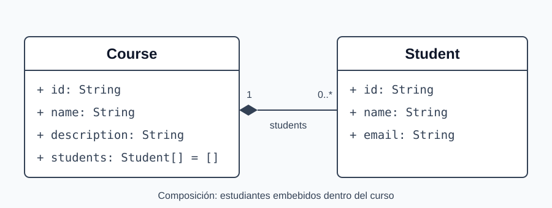

# CRUD de cursos y estudiantes

Ejercicio básico de una API JSON con Node.js, Express y pnpm. Completa los `TODO` de `server.cjs`; el scaffold responde `501` hasta implementar cada operación.

## Modelo de datos



Un curso contiene un arreglo de estudiantes embebidos. No existe una colección independiente de estudiantes ni endpoints adicionales para ellos. Los cursos se guardan en la colección `courses` de MongoDB. Los estudiantes viven dentro de cada documento de curso.

```json
{
  "id": "507f1f77bcf86cd799439011",
  "name": "Bases de datos II",
  "description": "Introducción a bases de datos documentales",
  "students": [
    {
      "id": "student-1",
      "name": "Ana García",
      "email": "ana@example.com"
    }
  ]
}
```

- `Course.id`: string no vacío generado a partir del `_id` de MongoDB (`ObjectId`). La API expone `id`, no `_id`. Se conserva al actualizar.
- `Course.name`: string obligatorio, no vacío ni compuesto solo por espacios.
- `Course.description`: string obligatorio; puede estar vacío.
- `Course.students`: arreglo de objetos `Student`. En POST, si se omite, se guarda como `[]`.
- Cada estudiante lleva `id`, `name` y `email` como strings no vacíos. El cliente proporciona estos tres campos. Para este ejercicio no se exige validar el formato del email ni relaciones entre cursos.

## Contrato de la API

Envía `Content-Type: application/json` en POST y PUT. Las respuestas tienen contenido JSON, excepto el DELETE exitoso, que no lleva cuerpo.

| Método | Ruta | Resultado esperado |
| --- | --- | --- |
| GET | `/courses` | `200`: arreglo de cursos; inicialmente `[]` |
| GET | `/courses/:id` | `200`: objeto curso; `404` si no existe |
| POST | `/courses` | `201`: curso creado con su ID y sus estudiantes |
| PUT | `/courses/:id` | `200`: curso actualizado; `404` si no existe |
| DELETE | `/courses/:id` | `204`: sin cuerpo; `404` si no existe |

POST recibe `name`, `description` y opcionalmente `students`. PUT recibe `name`, `description` y `students`, y reemplaza esos tres campos manteniendo el ID. Para agregar, modificar o eliminar estudiantes, envía el arreglo completo actualizado mediante PUT.

En PUT, los datos inválidos producen `400` con un objeto JSON `{ "message": "Explicación del error" }`. Los errores `404` usan la misma estructura. El texto del mensaje es libre, pero no debe estar vacío. Un PUT inválido no modifica los datos guardados. Para esta primera práctica, POST asume que recibe datos con el formato del ejemplo y no incluye validaciones.

## 1. Requisitos

Versiones base para este ejercicio:

- Node.js **22.21 o superior**.
- pnpm **10 o superior**.
- Docker Engine **24 o superior**, o Docker Desktop con el motor iniciado.
- Puerto **27017** libre para MongoDB y **3000** para la API.
- curl y, opcionalmente, Bruno para enviar solicitudes.

```bash
node --version
pnpm --version
docker version
pnpm install
```

Los comandos se ejecutan desde la raíz del proyecto. Los ejemplos de terminal usan Bash o Zsh.

## 2. Lanzar MongoDB Community en Docker

```bash
docker run --detach \
  --name ucp-mongo \
  --publish 127.0.0.1:27017:27017 \
  --volume ucp-mongo-data:/data/db \
  mongodb/mongodb-community-server:8.0-ubi8
```

El puerto 27017 del contenedor queda disponible en el 27017 de tu máquina. El volumen conserva los datos entre reinicios. Este entorno de práctica no usa autenticación y solo se publica en la interfaz local.

Comprueba que esté listo:

```bash
docker logs ucp-mongo
docker exec ucp-mongo mongosh --quiet --eval 'db.runCommand({ ping: 1 })'
```

El ping debe mostrar `ok: 1`. Para sesiones posteriores usa `docker stop ucp-mongo` y `docker start ucp-mongo`; no repitas `docker run` si el contenedor ya existe. Si otro MongoDB ocupa el puerto, reutiliza ese servicio local o libera el puerto antes de crear este contenedor.

## 3. Instalar el driver oficial

```bash
pnpm add mongodb
```

Usaremos el driver oficial `mongodb`, sin Mongoose. Ya está registrado en las dependencias del template; el comando muestra cómo agregarlo en un proyecto nuevo.

## 4. Configurar la conexión local

```bash
cp .env.example .env
```

Contenido de `.env`:

```dotenv
MONGODB_URI=mongodb://127.0.0.1:27017
MONGODB_DB=ucp_courses
PORT=3000
```

`.env` está ignorado por Git. Los scripts `pnpm dev`, `pnpm start` y `pnpm test` cargan estas variables con la opción nativa de Node `--env-file-if-exists=.env`, sin necesitar `dotenv`. La API corre en tu máquina y se conecta al puerto publicado por Docker.

## 5. Conectar Express a MongoDB

**Los siguientes bloques son código para que incorpores a `server.cjs`.** El scaffold mantiene sus `TODO`; la guía resuelve listar y crear, y deja las otras tres operaciones como ejercicio.

Agrega junto a los imports:

```js
const { MongoClient } = require('mongodb');
```

No cambies el bloque de arranque al final del archivo. En cada endpoint crearemos un `MongoClient`, abriremos la conexión y elegiremos la base de datos y la colección. Al terminar, cerraremos la conexión con `finally`, tanto si la operación funciona como si falla.

MongoDB crea la base y la colección al insertar el primer documento.

## 6. Listar cursos sin paginación

Reemplaza el handler de `GET /courses`:

```js
app.get('/courses', async (req, res) => {
  const client = new MongoClient(process.env.MONGODB_URI);

  try {
    await client.connect();
    const db = client.db(process.env.MONGODB_DB);
    const collection = db.collection('courses');

    const documents = await collection.find({}).toArray();
    const courses = documents.map(({ _id, ...course }) => ({
      id: _id.toString(),
      ...course,
    }));
    res.status(200).json(courses);
  } catch (error) {
    console.error(error);
    res.status(500).json({ message: 'No se pudieron listar los cursos' });
  } finally {
    await client.close();
  }
});
```

`find({})` consulta todos los documentos y `toArray()` los convierte en un arreglo. No usamos filtros, límite ni paginación en este ejercicio.

## 7. Crear un curso con estudiantes embebidos

Reemplaza el handler de `POST /courses`:

```js
app.post('/courses', async (req, res) => {
  const { name, description, students = [] } = req.body || {};
  const course = { name, description, students };

  const client = new MongoClient(process.env.MONGODB_URI);

  try {
    await client.connect();
    const db = client.db(process.env.MONGODB_DB);
    const collection = db.collection('courses');

    const result = await collection.insertOne(course);
    res.status(201).json({
      id: result.insertedId.toString(),
      name: course.name,
      description: course.description,
      students: course.students,
    });
  } catch (error) {
    console.error(error);
    res.status(500).json({ message: 'No se pudo crear el curso' });
  } finally {
    await client.close();
  }
});
```

`insertOne` guarda el curso y genera su `_id`. Omitir `students` equivale a enviar `[]`. Por ahora no validamos los datos de entrada en este endpoint.

Inicia la API después de aplicar los bloques:

```bash
pnpm dev
```

## 8. Crear datos de ejemplo con curl

Crear un curso con una estudiante:

```bash
curl -i -X POST http://localhost:3000/courses \
  -H 'Content-Type: application/json' \
  -d '{"name":"Bases de datos II","description":"Bases documentales","students":[{"id":"student-1","name":"Ana García","email":"ana@example.com"}]}'
```

Crear otro curso sin estudiantes y listar ambos:

```bash
curl -i -X POST http://localhost:3000/courses \
  -H 'Content-Type: application/json' \
  -d '{"name":"Programación web","description":"API con Express"}'

curl -i http://localhost:3000/courses
```

Copia el `id` que devuelve POST para las operaciones que implementarás después:

```bash
COURSE_ID='pega-aqui-el-id-devuelto'
curl -i "http://localhost:3000/courses/$COURSE_ID"

curl -i -X PUT "http://localhost:3000/courses/$COURSE_ID" \
  -H 'Content-Type: application/json' \
  -d '{"name":"Bases de datos II actualizado","description":"CRUD con MongoDB","students":[]}'

curl -i -X DELETE "http://localhost:3000/courses/$COURSE_ID"
```

Estas tres últimas rutas todavía responderán `501` hasta que las completes. Para consultar directamente los documentos guardados:

```bash
docker exec ucp-mongo mongosh ucp_courses --quiet --eval 'db.courses.find().toArray()'
```

## 9. Probar todos los endpoints con Bruno

1. Abre Bruno y selecciona **Open Collection**.
2. Abre la carpeta [`bruno`](bruno) de este repositorio.
3. Selecciona el entorno **Local** (`baseUrl = http://localhost:3000`).
4. Ejecuta **01 Crear curso**. Su script guarda automáticamente el `id` en la variable de ejecución `courseId` cuando recibe `201`.
5. Ejecuta listar, consultar, actualizar y eliminar en ese orden. Las solicitudes usan `{{baseUrl}}` y `{{courseId}}`.
6. Para trabajar con otro curso, crea uno nuevo o copia su ID en `courseId` del entorno y limpia la variable de ejecución anterior en Bruno. Al reiniciar Bruno puedes volver a ejecutar Crear.

PUT incluye un estudiante modificado. Cambia `students` a `[]` para practicar su eliminación. DELETE elimina el curso seleccionado; vuelve a crear uno para repetir el recorrido. Cada solicitud incluye una comprobación básica del estado HTTP esperado.

## 10. Completar el ejercicio y ejecutar las pruebas

Implementa consultar por ID, actualizar y eliminar usando `findOne`, `updateOne` (con `$set`) y `deleteOne`. Importa `ObjectId` desde `mongodb` para buscar por `{ _id: new ObjectId(req.params.id) }`. Comprueba primero `ObjectId.isValid(req.params.id)` y responde `404` cuando el ID no sea válido o el curso no exista. No modifiques `_id` en PUT. Devuelve `id` como string en todas las respuestas de cursos.

```bash
pnpm test
```

Las 20 pruebas usan `node:test`, Supertest y MongoDB real. No necesitas iniciar la API aparte, pero MongoDB debe estar funcionando. Cada ejecución crea una base temporal `ucp_courses_test_<UUID>`, vacía solo su colección antes de cada caso y elimina esa base al terminar. Durante las pruebas, `MONGODB_DB` apunta a esa base temporal y `MONGODB_URI` al servidor de pruebas. Al terminar se restauran ambas variables; no se borra la base del ejercicio. Si necesitas otro servidor para pruebas, configura `MONGODB_TEST_URI`; de lo contrario se usa `MONGODB_URI` o la conexión local.

Conserva `module.exports = app` y el arranque dentro de `require.main === module`. En cada endpoint usa `process.env.MONGODB_URI` y `process.env.MONGODB_DB`, como en los ejemplos, para que las pruebas puedan elegir su base temporal. Cierra siempre la conexión en `finally`.

**Las pruebas fallan al inicio por las respuestas `501`.** Tras copiar los ejemplos de listar y crear pasarán los casos correspondientes; los demás requieren completar el CRUD. Si MongoDB no está disponible, primero corrige la conexión: ese error de infraestructura no es un fallo de la lógica CRUD.

## Referencias

- [Express 5: instalación (español)](https://expressjs.com/es/5x/starter/installing/)
- [MongoDB Community en Docker](https://www.mongodb.com/docs/v8.0/tutorial/install-mongodb-community-with-docker/)
- [MongoDB: insertar documentos con el driver de Node.js (español)](https://www.mongodb.com/es/docs/drivers/node/current/crud/insert/)
- [Driver oficial: operaciones CRUD](https://www.mongodb.com/docs/drivers/node/current/reference/quick-reference/)
- [Node.js: carga nativa de archivos de entorno](https://nodejs.org/api/cli.html#--env-file-if-existsfile)
- [Variables de Bruno](https://blog.usebruno.com/manage-variables)
